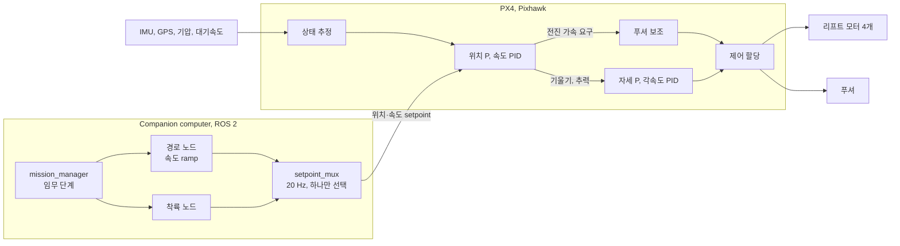
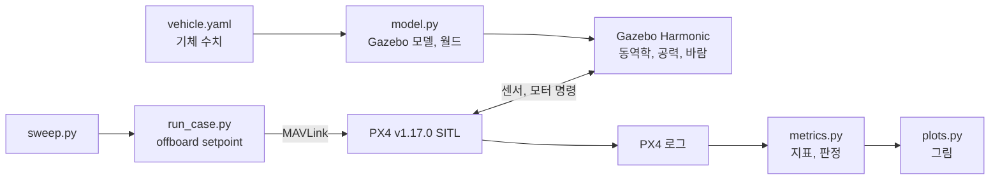
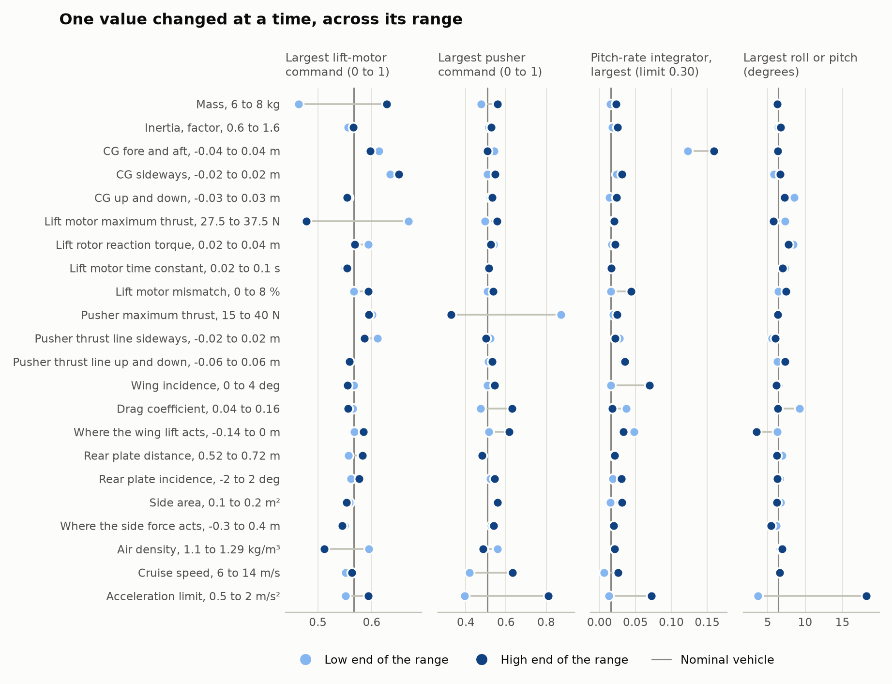
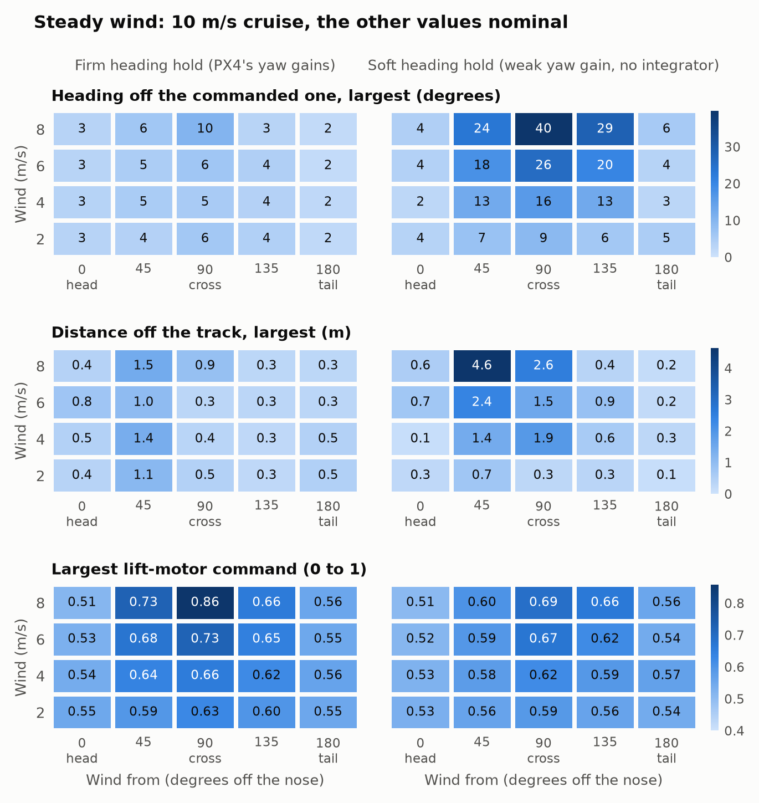
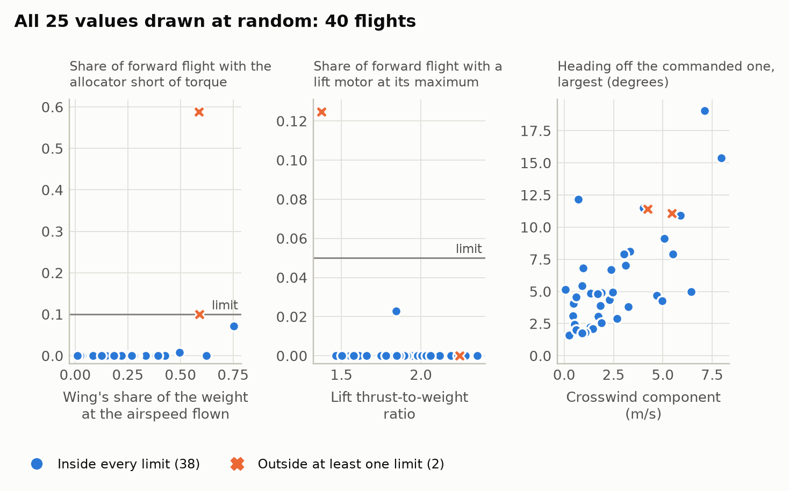
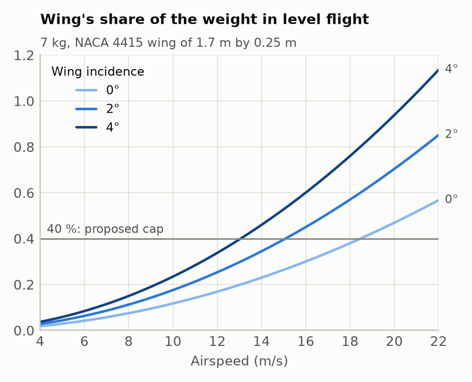

# 연말 비행: 기체 제어 설계

2026-10-08 기준, 브랜치 `year-end-flight`. 이 프로젝트의 문서는 이 파일 하나입니다.

시뮬레이션으로만 확인했고 실제 비행은 하지 않았습니다. 기체 수치의 일부는 동체팀 자료이고
나머지는 가정입니다(5.2절).

## 1. 기체


| 항목 | 값 | 출처 |
|---|---|---|
| 전비중량 | 7 kg | eCalc 계산 기준 |
| 주익 | NACA 4415, 스팬 1700 mm, 시위 250 mm, 1.5 kg | 동체팀 |
| 리프트 모터 4개 | 전후 665 mm, 좌우 505 mm 직사각형의 꼭짓점 | 동체팀 |
| 푸셔 1개 | 동체 뒤 | 위치·사양 미정 |
| 뒤쪽 평판 | 475 × 150 mm, 붐 사이. 수직 꼬리 없음 | 동체팀 |
| 동체 | 710 × 205 × 215 mm | 동체팀 |
| 리프트 추력 대 중량비 | 1.9 | eCalc |
| 호버 시간 | 10.6분 | eCalc |

### 제어할 수 있는 곳

명령할 수 있는 것은 모터 다섯 개의 추력뿐입니다. 조종면이 없고, 날개와 평판은 고정입니다.

| 움직임 | 무엇으로 만드는가 | 여유 |
|---|---|---|
| 고도 | 리프트 로터 4개의 추력 합 | 추력비 1.9 |
| Roll | 좌우 리프트 로터의 추력 차 | 큼 |
| Pitch | 앞뒤 리프트 로터의 추력 차 | 큼 |
| Yaw (기수 방향) | 회전 방향이 다른 두 쌍의 반토크 차 | 가장 작음 |
| 전진 | 푸셔 추력 | 푸셔 최대 추력 |
| 감속 | 푸셔를 끄고 리프트 로터로 기수를 듦 | |
| 옆 이동 | 리프트 로터로 기체를 옆으로 기울임 | |

날개 양력은 제어할 수 없습니다. 속도가 붙으면 저절로 생기고, 그만큼 리프트 로터의 부담을
덜어 갑니다.

## 2. 임무


| 단계 | 내용 |
|---|---|
| 이륙, 상승 | 제자리에서 목표 고도까지 |
| 천이 | 호버에서 순항 속도까지 가속 |
| 수평 이동 | 순항 속도로 setpoint까지 |
| 역천이 | 착륙 지점 위에서 호버로 감속 |
| 하강, 착륙 | 제자리에서 지면까지 |

시뮬레이션에서 비행한 프로파일입니다. 고도 20 m, 순항 10 m/s, 가속 한계 1 m/s².


## 3. 제어 방법

이륙부터 착륙까지 멀티콥터로 비행합니다. 푸셔는 그 멀티콥터에 달린 다섯 번째 액추에이터로,
전진력만 냅니다. 날개는 얹혀 갑니다.

### 단계별 제어

| 단계 | 미션 노드가 보내는 setpoint | 리프트 로터 | 푸셔 |
|---|---|---|---|
| 이륙, 상승 | 이륙 지점 위치, 목표 고도 | 자세와 고도 | 꺼짐 |
| 천이 | 진행 방향 속도를 가속 한계로 올림, 고도 유지 | 자세와 고도 | 전진 가속 요구만큼 올라감 |
| 수평 이동 | 경로 방향 속도 또는 위치 | 무게에서 날개 양력을 뺀 만큼 | 항력만큼 유지 |
| 역천이 | 속도를 가속 한계로 내림, 이어서 착륙 지점 위치 | 기수를 들어 제동 | 0으로 |
| 하강 | 수직 속도, 위치 유지 | 전부 | 바람이 전진력을 요구할 때만 |
| 착륙 | PX4 Land 모드 | 전부 | 하강과 같음 |

### 제어 방법

- **기본은 PX4의 멀티콥터 PID 계단입니다.** 위치 P → 속도 PID → 자세 P → 각속도 PID → 할당.
  수정 없이 그대로 씁니다.
- **푸셔는 기수 숙임을 대신합니다.** 속도 루프가 전진 가속을 요구하면, PX4가 기체를 수평으로
  둔 채 그 요구를 푸셔 추력으로 바꿉니다(`VT_FWD_THRUST_EN`). 감속은 반대로, 푸셔를 0으로
  내리고 리프트 로터가 기수를 듭니다.
- **"천이"는 모드 전환이 아니라 속도 ramp입니다.** 명령 속도가 가속 한계를 지키며 올라가고,
  역천이에서는 같은 방식으로 내려갑니다.
- **고정익 모드는 쓰지 않습니다.** PX4의 고정익 모드는 리프트 로터를 끄고 조종면으로 자세를
  잡습니다. 조종면이 없는 이 기체에서는 제어를 잃습니다. 천이 명령은 절대 보내지 않습니다.

## 4. 구현

### 구성



- **PX4는 stock 그대로입니다.** 펌웨어 코드를 고치지 않고 파라미터만 설정합니다.
- **Companion은 어디로 갈지만 보냅니다.** 안정화는 전부 PX4가 합니다.

### PX4 설정

Airframe은 standard VTOL(`CA_AIRFRAME 2`, `VT_TYPE 2`), 로터 5개, 서보 없음입니다.

| 파라미터 | 값 | 이유 | 값의 출처 |
|---|---|---|---|
| `CA_ROTOR_COUNT` | 5 | 리프트 4 + 푸셔 1 | 고정 |
| `CA_ROTOR0..3_PX`, `_PY` | CG 기준 ±0.3325, ±0.2525 m | 할당 기하 | 동체팀 치수. CG 위치는 확인 필요 |
| `CA_ROTOR4_AX`, `_AZ` | 1, 0 | 푸셔 추력이 앞을 향함 | 고정 |
| `CA_ROTOR4_PZ` | 0 | 추력선 오프셋은 pitch 적분기에 맡김 | 결정 |
| `CA_SV_CS_COUNT` | 0 | 조종면 없음 | 고정 |
| `VT_FWD_THRUST_EN` | 4 | 멀티콥터 모드에서 푸셔가 전진력을 냄 | 결정 |
| `VT_PITCH_MIN` | 0 | 기수를 숙이지 않음 | 결정 |
| `VT_FWD_THRUST_SC` | 무게 / 푸셔 최대 추력 | PX4가 요구한 가속도와 푸셔가 내는 가속도를 맞춤 | 푸셔 벤치 측정. 시뮬레이션 2.75 |
| `THR_MDL_FAC` | 추력 곡선 모양 | 명령과 추력을 비례하게 함 | 벤치 측정. eCalc로는 약 0.35 |
| `CA_R4_SLEW` | 1.0 s | 푸셔 명령이 0에서 최대까지 최소 1초 | 결정, 튜닝 대상 |
| `MC_YAWRATE_K` | 튜닝. 시뮬레이션 3 | 이 기체는 요 권한이 PX4 기본 모델의 약 1/3 | 호버 튜닝 |
| `MPC_XY_VEL_MAX` | 순항 속도보다 크게 | 아니면 PX4가 명령 속도를 자름 | 순항 속도 |
| `WV_EN` | 0 | 기수는 미션 노드가 명령 | 결정 |
| `SYS_HAS_NUM_ASPD` | 대기속도 센서 장착 시 1 | Arming 체크 | 하드웨어 |

### 미션 노드 규칙

- 지금처럼 `setpoint_mux`를 거쳐 위치 또는 속도 setpoint만 보냅니다.
- 명령 속도는 가속 한계(시작값 1 m/s²)보다 빨리 바꾸지 않습니다. PX4는 offboard setpoint를
  smoothing 없이 쓰므로, setpoint의 계단은 곧 푸셔 명령의 계단입니다.
- 기수는 진행 방향으로 둡니다. 푸셔는 기수 방향으로만 밉니다.
- 순항 속도는 날개가 무게의 작은 부분만 드는 범위에 둡니다(5.4절).
- VTOL 천이 명령은 보내지 않습니다.

### PX4에서 천이를 명령할 수 있는 경로

세 군데이고 모두 막아야 합니다. v1.17.0 소스를 검색해 찾았고 전수 감사는 아닙니다.

- 명령 `VEHICLE_CMD_DO_VTOL_TRANSITION`: 노드가 보내지 않고, RC 천이 스위치를 매핑하지 않습니다.
- 미션과 VTOL 이륙 미션 항목: 미션을 올리지 않습니다.
- 미션 착륙을 따라가는 Return 모드: 미션이 없으면 멀티콥터로 곧장 돌아옵니다. `RTL_TYPE 0`으로
  명시합니다.

## 5. Simulation: Gazebo SITL

### 5.1 방법



- 실제 PX4 펌웨어가 Gazebo 안의 기체를 비행시킵니다. 제어기를 따로 흉내 내지 않습니다.
- setpoint는 ROS 2 노드가 보내는 것과 같은 offboard 위치·속도 setpoint입니다.
- 이륙부터 착륙까지 2절의 프로파일 전체를 비행하고, PX4 로그에서 지표를 뽑습니다.
- 통과 기준: 프로파일 완료, roll·pitch 30° 미만, 고도 오차 3 m 미만, 리프트 모터가 최대치에
  머문 시간 5% 미만, 할당기가 요구 토크를 못 낸 시간 10% 미만.

```bash
python3 year_end_flight/sim/run_case.py                 # 기준 기체
python3 year_end_flight/sim/sweep.py oat --jobs 4       # 값을 하나씩
python3 year_end_flight/sim/sweep.py wind --jobs 4      # 바람 속도와 방향
python3 year_end_flight/sim/sweep.py random --n 40      # 전부 동시에
python3 year_end_flight/sim/plots.py                    # 그림
```

WSL에서 실행하며, 빌드된 PX4 v1.17.0과 Gazebo Harmonic, pymavlink, pyulog가 필요합니다.

### 5.2 기체 모델

`sim/vehicle.yaml`에 값마다 출처를 적었습니다. 실제 기체에서 측정한 값은 없습니다.

- **받은 값**: 질량 7 kg, 날개 치수와 에어포일, 모터 위치, 평판 치수, 동체 치수.
- **받은 값에서 계산한 값**: 리프트 최대 추력과 프로펠러 반토크(eCalc), 평판 위치.
- **가정한 값**: 관성 모멘트, CG가 모터 네 개의 중심에 있다는 것, 날개의 전후 위치와 붙임각,
  푸셔의 추력(25 N)과 위치, 평판 붙임각, 항력 계수.

통과는 "이런 기체에서 이 제어 개념이 성립한다"는 뜻이지, 실제 기체의 검증이 아닙니다.

### 5.3 결과

| 스윕 | 통과 | 내용 |
|---|---|---|
| 기준 기체 | 통과 | 7 kg, 순항 10 m/s, 무풍 |
| 값을 하나씩 | 48 / 48 | 불확실한 값 25개를 범위 양 끝으로 |
| 바람 | 40 / 40 | 2, 4, 6, 8 m/s × 다섯 방향 × 기수 유지 설정 두 가지 |
| 전부 동시에 | 38 / 40 | 25개 값을 무작위로. 40회 모두 전 구간 비행 후 착륙 |

**기준 기체**

| 지표 | 값 |
|---|---|
| 가속·순항 중 pitch | ±0.7° 이내 |
| 제동 중 pitch | 기수 들림 6.4° |
| 고도 오차 | 최대 0.39 m |
| 순항 속도 | 명령 10에 9.94 m/s |
| 푸셔 명령 | 순항 0.23, 최대 0.51 |
| 리프트 모터 명령 | 호버 0.52, 순항 0.47 |

호버 명령 0.52는 eCalc의 추력비 1.9에서 나오는 값(1/1.9 = 0.53)과 맞습니다. 순항에서 10%
내려가는 것은 날개가 그만큼을 들기 때문이고, 날개 자료로 계산한 값은 12%입니다.

**값을 하나씩 바꿨을 때**



| 바꾼 것 | 영향 |
|---|---|
| 질량 6–8 kg | 리프트 명령 최대 0.46–0.63 |
| CG 전후 ±4 cm | pitch 적분기 사용이 가장 큼: 한계 0.30 중 0.16 |
| 푸셔 추력선 상하 ±6 cm | pitch 적분기 0.03–0.04. CG 영향의 1/4 |
| 푸셔 최대 추력 15–40 N | 푸셔 명령 최대 0.87–0.33 |
| 가속 한계 0.5–2 m/s² | 제동 시 기수 들림 3.7°–18.2°, 푸셔 명령 최대 0.39–0.81 |
| 정풍 8 m/s | 순항 리프트 명령 0.34. 대기속도 약 18 m/s에서 날개가 36%를 듦 |
| 측풍 8 m/s | 기울기 12°, 요 적분기 0.23, 리프트 명령 최대 0.82. 포화 없음 |

**바람**



| | 기본 기수 유지 (PX4 요 게인) | 부드러운 기수 유지 (약한 요 게인) |
|---|---|---|
| 기수 오차 | 최대 10° | 최대 40° |
| 경로 이탈 | 최대 1.5 m | 최대 4.6 m |
| 요 적분기 (한계 0.30) | 최대 0.26 | 쓰지 않음 |
| 리프트 모터 포화 | 없음 | 없음 |

기본 설정을 씁니다. 경로를 더 잘 따라가고, 8 m/s 측풍까지 여유가 남습니다.

**전부 동시에**



40회 모두 프로파일을 끝까지 비행하고 착륙했습니다. 가장 큰 기울기는 22°, 가장 큰 고도 오차는
1.2 m입니다. 한계를 벗어난 2건은 둘 다 대기속도 19 m/s에서 날개가 무게의 59%를 든 경우입니다.

- 한 건은 요구 토크를 낼 수 없는 시간이 59%였습니다(정풍·측풍 성분이 각각 5.5 m/s).
- 다른 한 건은 질량 7.9 kg, 추력비 1.37로, 리프트 모터가 최대치에 12% 머물렀습니다.

### 5.4 알게 된 것



- **개념이 동작합니다.** 기체는 수평으로 두고, 전진력은 푸셔가, 나머지는 리프트 로터가 맡는
  구조로 프로파일 전체를 비행했습니다.
- **속도 상한은 날개가 정합니다.** 날개가 무게의 큰 부분을 들면 리프트 로터가 0 근처까지
  내려가 자세를 잡을 힘이 없어집니다. 날개 부담 40% 미만인 34건은 전부 통과했고, 그 이상인
  6건 중 2건이 한계를 벗어났습니다. 붙임각 0°면 대기속도 약 18 m/s, 4°면 약 13 m/s가 40%입니다.
- **기준은 대지속도가 아니라 대기속도입니다.** 정풍이 여유를 깎습니다.
- **Yaw가 가장 약한 축입니다.** 반토크로만 기수를 돌리므로 요 게인을 3배 올려야 했습니다.
- **추력선 오프셋보다 CG가 중요합니다.** pitch 적분기 사용량이 4배 차이 납니다.

### 5.5 모델에 없는 것

- 날개 자체의 pitch 모멘트. Gazebo 플러그인에 없어서 양력 작용점(`wing_cp_x_m`)으로 대신하고
  그 값을 스윕했습니다.
- 날개 후류가 평판에 주는 영향, 로터 후류가 날개에 주는 영향, 기체의 휨.
- 뒤에서 오는 바람의 공력. 플러그인이 0으로 계산하므로 배풍 호버 결과는 낙관적입니다.
- 진동, 센서 고장, 배터리 전압 강하.
- ROS 2 노드. 지금은 MAVLink 스크립트가 같은 setpoint를 대신 보냅니다.
- 자세 게인은 PX4 기본값이고, 이 기체에 맞춰 튜닝하지 않았습니다(요 게인만 조정).

## 6. 해야 할 일

1. **동체팀 수치 확정.** CG 위치, 날개의 전후 위치와 붙임각, 평판 붙임각, 푸셔의 모터·프로펠러와
   위치, 7 kg이 전비중량인지.
2. **벤치 측정.** 푸셔와 리프트 모터 하나의 추력 곡선. `VT_FWD_THRUST_SC`와 `THR_MDL_FAC`를
   정하고 eCalc 값을 확인합니다. eCalc는 최대 추력에서 모터 온도 92°C를 경고했습니다.
3. **펌웨어 버전 결정.** repo의 ROS 2 메시지는 PX4 1.15에 맞춰져 있고, 시뮬레이션은 1.17.0에서
   돌렸습니다.
4. **PX4 airframe 설정 파일 작성.** 4절의 표를 파일로.
5. **미션 노드 수정.** `generator_tracking.py`는 아직 천이 명령을 보내고 12 m/s 고정익 Dubins
   경로를 따릅니다. 천이 명령과 고정익 경로를 빼고, 속도 ramp를 넣고, vision 없이 고정 지점에
   착륙하게 합니다.
6. **ROS 2 노드를 포함한 SITL 통합 시험.**
7. **비행 시험.** 구속 호버 → 호버 튜닝(요 게인 포함) → 저속 푸셔 → 속도를 단계적으로 올림 →
   전체 임무. eCalc의 호버 시간 10.6분이 임무 전체의 상한입니다.

## 7. 향후 과제

- **대기속도 기준 속도 상한.** 첫 번째 확장입니다. `/fmu/out/airspeed_validated`로 명령 속도를
  제한해 날개 부담을 40% 아래로 유지합니다. 그 전까지는 예상되는 가장 센 정풍에 맞춰 순항
  속도를 낮게 잡습니다.
- **요 권한 증대.** 측풍 비행이 필요하면 리프트 모터를 몇 도 기울이는 것이 일반적인 방법입니다.
- **추력선 오프셋 feedforward** (`CA_ROTOR4_PZ`). PX4의 stock 푸셔 기체들도 쓰지 않고, 넣으면
  푸셔 명령의 배율이 바뀌는 것으로 보이며, 시뮬레이션상 얻을 것이 적습니다.
- **지면 근처에서 푸셔 보조 끄기** (`VT_FWD_THRUST_EN 1`).
- **공력 모델 개선.** 날개 자체의 모멘트와 후류를 넣습니다.
- **실제 고정익 천이.** 조종면이 필요하고, 이 설계의 범위 밖입니다.
- **Vision 정밀 착륙과 RL.** 이 repo의 다른 작업이며 이번 비행에서는 뺐습니다.

## 8. 질문과 답

**천이 때 푸셔를 점진적으로 올리면 제어가 더 안정한가**

네. 푸셔 추력이 천천히 변하면 추력선 오프셋 모멘트와 날개 양력 변화가 천천히 들어와서, 리프트
로터의 자세·고도 루프가 따라가기 쉽습니다. 두 가지로 구현합니다.

- 미션 노드가 명령 속도를 가속 한계 안에서 올립니다.
- `CA_R4_SLEW`가 푸셔 명령 자체의 변화율을 제한합니다(0에서 최대까지 최소 1초).

시뮬레이션에서 가속 한계를 0.5, 1, 2 m/s²로 바꾸면 푸셔 명령 최대가 0.39, 0.51, 0.81로,
제동 시 기수 들림이 3.7°, 6.4°, 18.2°로 커졌습니다.

**`VT_PITCH_MIN = 0`이면 수평 이동을 시작할 때 갑자기 켜지는가**

on/off가 아니라 비례입니다. 푸셔 명령은 속도 루프가 요구하는 전진 가속에 비례하고 0에서
시작합니다. 다만 가속 명령 자체가 처음부터 가속 한계 크기로 들어오므로, 천이 시작 직후 약
0.5초 만에 푸셔가 0.35까지 올라갑니다(2절 그림의 맨 아래). 이 구간에서 pitch는 ±0.2° 안에
머물렀습니다. 더 부드럽게 하려면 가속 한계를 낮추거나, 속도 명령의 시작을 S자로 다듬거나,
`CA_R4_SLEW`를 늘립니다.

기본값 -5°가 오히려 불연속입니다. 요구 pitch가 -5°를 넘는 순간 기수가 0°로 돌아가는데 푸셔는
그때 0에서 시작합니다.

**푸셔 추력선이 CG와 위아래로 어긋나면**

리프트 로터의 pitch 각속도 제어기 적분기가 흡수합니다. 오프셋 길이를 몰라도 되므로, 이론값과
실제가 달라도 상관없습니다. 시뮬레이션에서 ±6 cm 오프셋에 적분기는 한계 0.30 중 0.03–0.04를
썼고, CG ±4 cm는 0.12–0.16을 썼습니다. 줄이려면 배터리 높이를 옮기거나 푸셔 마운트를 기울여
추력선이 CG를 지나게 합니다. `CA_ROTOR4_PZ`로 할당에 넣는 방법은 7절의 이유로 쓰지 않습니다.

**대기속도 센서**

Stock PX4는 멀티콥터 모드에서 대기속도를 제어에 쓰지 않습니다. 상태 추정의 대기속도 융합도
고정익 모드에서만 됩니다. 이 기체에서 쓸 곳은 속도 상한입니다. 날개 양력은 대기속도로 정해지고,
5.4절처럼 날개가 무게의 큰 부분을 들면 제어 여유가 사라지기 때문입니다. 센서는 달되, 제어에
쓰는 것은 7절의 첫 번째 확장으로 둡니다.
